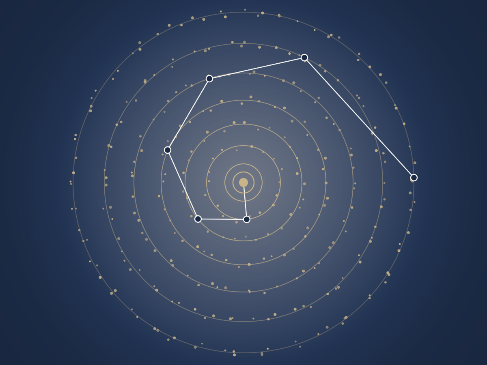
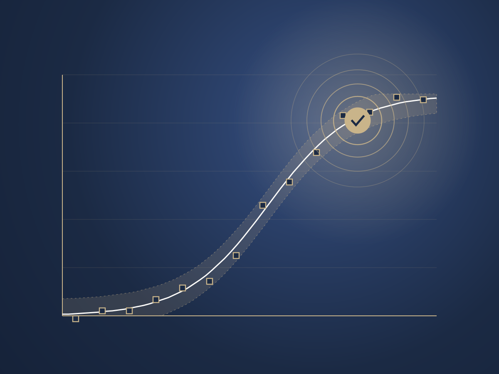
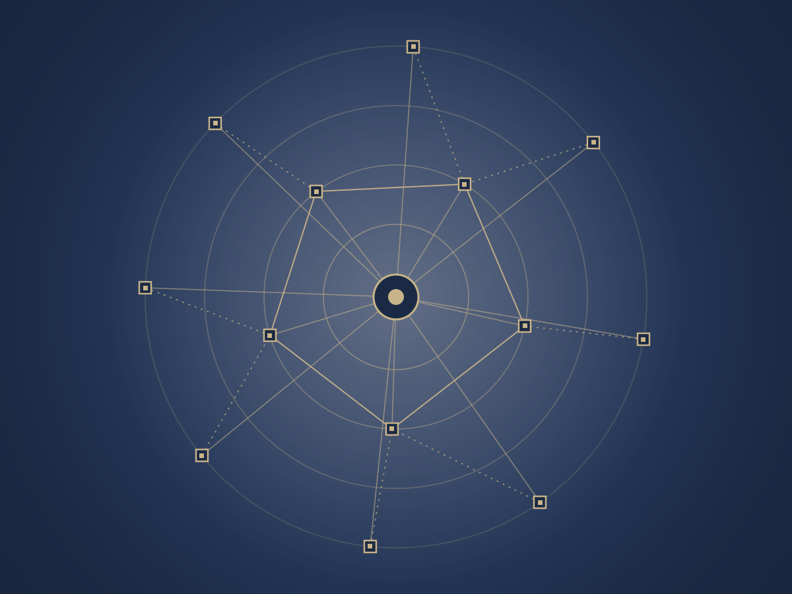

## Sobre

A Fortvna Risk Solutions constrói superinteligência para decisões de risco. Cada solução é desenhada para o cliente, entra na operação e passa a trabalhar todos os dias. Do produtor rural ao banco, da microempresa à grande empresa.

## Produtos e soluções

<table>
<tr>
<td width="38%"></td>
<td>
SUPERINTELIGÊNCIA DO AGRONEGÓCIO
<h3>Radiant Agro</h3>
O Tião, a superinteligência do agronegócio, no WhatsApp do produtor. Lê foto de nota, áudio, planilha e PDF, lança na operação e confirma com o produtor.  
Para bancos, cooperativas e seguradoras: o Índice Radiant de 0 a 1000, o dossiê de crédito e o Selo Radiant de conformidade socioambiental, conforme a Resolução CMN nº 5.268/2025.
</td>
</tr>
<tr>
<td></td>
<td>
SIMULAÇÃO DE POPULAÇÕES
<h3>Radiant Sim</h3>
Simula populações inteiras de clientes, tomadores e mercados e registra cada decisão. A mesma semente produz o mesmo resultado em qualquer máquina, e cada cenário pode ser reproduzido byte a byte.  
Estresse de carteira, comportamento de clientes, choques de mercado e mudanças de política, testados antes de acontecerem.
</td>
</tr>
<tr>
<td></td>
<td>
MODEL FACTORY AS A SERVICE
<h3>Fabric-Models</h3>
Agentes exploram os dados no ambiente do cliente, escolhem a família de modelo, constroem, otimizam e colocam o campeão contra os desafiantes e contra a política atual. O vencedor sai documentado, assinado e monitorado.  
Crédito e score, PD, LGD, EAD e ECL da Resolução CMN nº 4.966/2021, mercado, liquidez, estresse e políticas de crédito. O dado não sai do ambiente do cliente.
</td>
</tr>
<tr>
<td></td>
<td>
MRM AS A SERVICE
<h3>M-Evals</h3>
Agentes independentes revisam de ponta a ponta modelos de crédito, mercado, liquidez, score, políticas, inferência causal e IA generativa: dados, solidez conceitual, desempenho, estabilidade, estresse e explicabilidade.  
Cada conclusão é rastreável até o dado e o código, reproduzível e assinada digitalmente pelo validador responsável. Os controles seguem as Resoluções CMN nº 4.557/2017 e nº 4.966/2021, a SR 26-2, a PRA SS1/23 e o EU AI Act.
</td>
</tr>
</table>

## Agentes de IA

<table>
<tr>
<td width="50%"></td>
<td width="50%"></td>
</tr>
<tr>
<td valign="top">
<h3>ARX</h3>
Runtime de agentes duráveis, em Rust. Agentes de WhatsApp e de back-office que não param: se o servidor cai, o agente retoma do ponto exato em que parou. Funciona com 23 provedores de IA, tem aprovação humana com um toque e cada ferramenta isolada no sistema operacional.
</td>
<td valign="top">
<h3>VaultBrain</h3>
A memória da empresa. Busca por significado, por termos exatos como CPF, CNPJ e números de contrato, e pelo histórico de fatos, sabendo o que valia em cada data. Dados isolados por cliente, na infraestrutura do cliente.
</td>
</tr>
</table>

## Consultoria e formação

Cada projeto começa por um diagnóstico e tem escopo, prazo e entregáveis definidos na primeira conversa. Modelos, código e documentação ficam com o cliente.

- Modelos sob medida com o Fabric-Models: crédito, mercado, liquidez e políticas de concessão, com documentação técnica
- Validação independente de modelos com o M-Evals, com relatório de achados, plano de remediação e assinatura do validador
- Segundo cérebro corporativo com o VaultBrain, sobre os documentos e as decisões da empresa
- Palestras, mentorias e consultorias para empresários que querem usar superinteligência no próprio negócio

## A quem atendemos

Micro e pequenas empresas · Médias e grandes empresas · Agronegócio · Bancos médios, cooperativas e fintechs · FIDCs, gestoras e family offices

---

 
<picture>
  <source media="(prefers-color-scheme: dark)" srcset="assets/fortvna-lema-branco.svg">
  
</picture>
  
© 2026 Fortvna Risk Solutions

